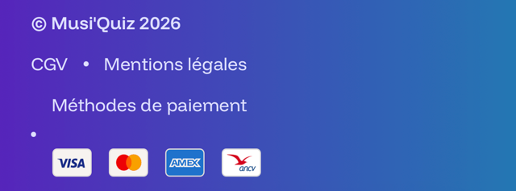

# P0 (top priorities)

- setup carto api key for production (restrict to domain) - BLOCKED
- 4escape todo file (CSP) - BLOCKED
- add apple pay file
- create worker from client account and invite me as admin

# P1 (important)

- Blog: add code block (youtube, instagram...)

# P2 (cosmetics)

- All preview in FR in Studio
  - French label in first
- cards image should also be clickable
- Dev bug in sanity studio: menus disappears
- Carousel arrows under, not above
- Footer revamp: make a grid
  - also: the bottom line can have weird display
  - the copyright should be last in this situation
- Center the pills in "Nos modes de jeux" Lille
- Rolling banner: parallax effect and array of string

- make the popup smaller
- Titles and subTitle for some components (ex: cardsGrid) should have more horizontal space
  - booking and home in lille
  - try full width

# Optional / Post-rollout

- Make Zod errors human readable in the build (optional)
- Cloudflare Access policy on musiquiz-ssr. It serves drafts
- Form security: prevent attacks
  - honey pot
  - rate limiting by IP
  - Origin/Referrer check
- Optimize build time (cache images and video)
