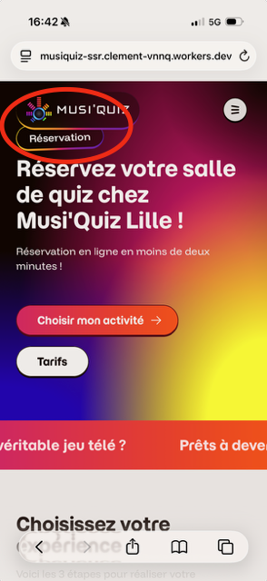

# P0 (top priorities)

- setup carto api key for production (restrict to domain)

# P1 (important)

- Cloudflare Access policy on musiquiz-ssr. It serves drafts
- Sanity UI should require localized strings
- Proper style on 404 page
- Blog: add code block (youtube, instagram...)
- Form security: prevent attacks
  - honey pot
  - rate limiting by IP
  - Origin/Referrer check
- UI bug: cards scroller z-index conflicts with header
- Header on mobile: booking button should always be there
- Tight page cover + badge = collapse
- preview icon in Sanity

- Weird line breaks with "?" and "!"
- Pour la version mobile, est-ce qu’il est possible pour les onglets Défis / Jokers / Thèmes de les centrer quand c’est retour à la ligne et sur les tarifs activités, on peut pas trouver un Moyer de les mettre sur une ligne quand il n’y en a que 2 ?

# P2 (cosmetics)

- burger mobile menu: book must be visible at the thumb area
- enter animation for cards (bottom to top)
- Stronger liquid glass effect on WhereToFindUs (https://musiquiz-ssr.clement-vnnq.workers.dev/lille Safari is doing it better)
- Logo strip: petit fondu en mode horizontal
- Translate UI to FR: https://www.sanity.io/docs/studio/localizing-studio-ui
- Dev bug in sanity studio: menus disappears
- Make Zod errors human readable in the build
- Mobile header not looking good, to investigate
- Carousel arrows under, not above
- Footer mobile, weird line breaks
- Top margin on mobile for booking page
- Footer revamp: make a grid
  - also: the bottom line can have weird display
  - the copyright should be last in this situation

- Titles and subTitle for some components (ex: cardsGrid) should have more horizontal space

# Questions

- is gifting widget/page required for all "hosted" venue?
- what is the format of 4escape widget ids?
